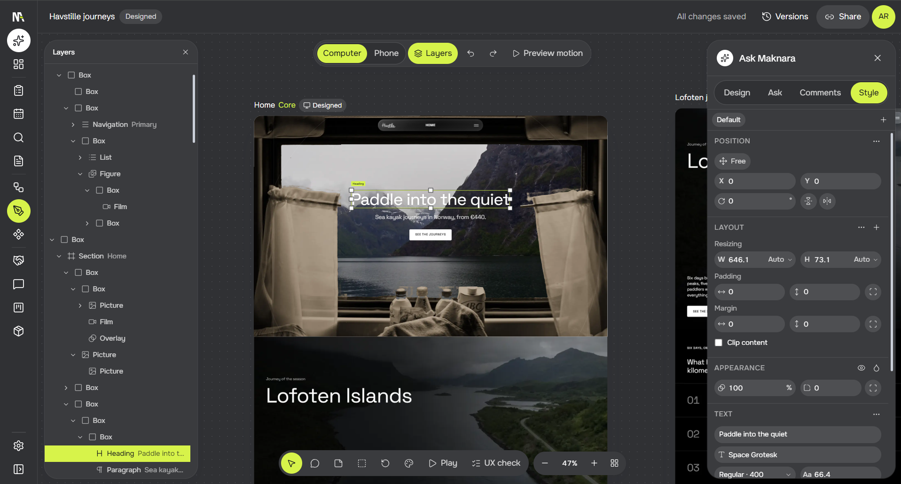
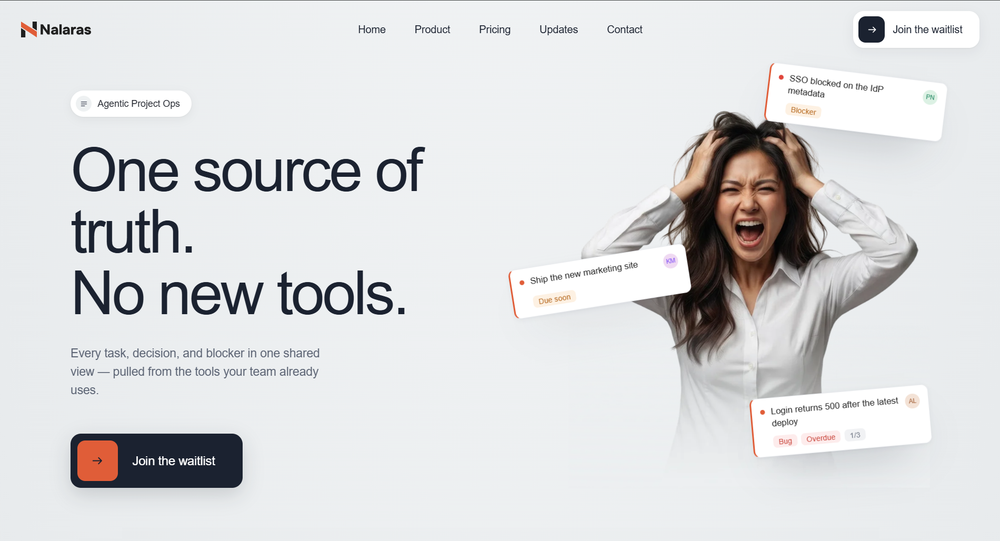
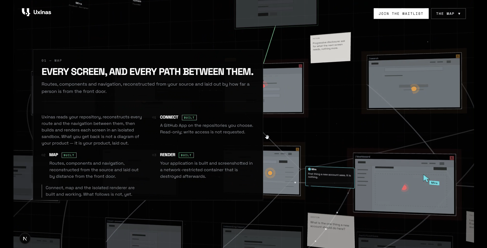

# Hey, I'm Alden Rai 👋

**Product Designer · AI Product Builder · Indie Founder**

I design and build digital products, combining product thinking, user experience design, and AI assisted development to turn ideas into functional products.

I'm particularly interested in the intersection of AI, product development, and design, exploring how AI can make building software more accessible, efficient, and intentional.

## 🚀 Featured Projects

### 01. Maknara

**From client idea to build ready, without the guesswork.**

Maknara is an AI powered client discovery and product design platform that helps teams transform early stage ideas into structured, validated, and build ready product specifications.

It bridges the gap between understanding what clients want and knowing what actually needs to be built.

**Key Capabilities**
* **AI Discovery:** Turn client ideas into structured product requirements through guided discovery and intelligent analysis.
* **Product Intelligence:** Analyze competitors, identify opportunities, and translate findings into actionable product insights.
* **AI Prototyping:** Transform requirements into interactive UI prototypes.
* **Scope Management:** Establish clear project expectations, track revisions, and distinguish between requested changes and additional scope.
* **Build Ready Documentation:** Generate structured product documentation to support the transition from design to development.

**My Role:** Founder, Product Designer, and AI Product Builder.

I lead product strategy, UX architecture, interface design, AI workflow development, and implementation.

**Status:** Private Development

---

### 02. Nalaras

**Know what needs your attention, before it becomes a problem.**

Nalaras is an AI powered operational intelligence platform that connects existing work tools and brings important signals, updates, and activities into one focused workspace.

Instead of constantly switching between platforms to understand what's happening, Nalaras helps teams identify what matters, understand why it matters, and determine what needs to happen next.

**Key Capabilities**
* **Unified Context:** Connect information across tools such as GitHub, Slack, Notion, and other work platforms.
* **Intelligent Monitoring:** Surface important updates, changes, and potential blockers.
* **Contextual Insights:** Explain why something needs attention and how it affects ongoing work.
* **AI Recommendations:** Suggest relevant actions based on connected information.
* **Operational Visibility:** Help teams maintain awareness of project activities without constantly checking multiple platforms.

**My Role:** Product Designer and AI Product Builder.

I worked on product strategy, UX architecture, interface design, interaction flows, and AI powered workflows.

**Status:** Private Project

---

### 03. Uxinas

**Find the UX problems AI generated interfaces might miss.**

Uxinas is an AI powered UX auditing platform designed to help product teams identify usability issues, understand their impact, and turn findings into actionable improvements.

It aims to bridge the gap between generating interfaces quickly and ensuring those interfaces deliver a genuinely good user experience.

**Key Capabilities**
* **UX Auditing:** Analyze websites and applications to identify usability and interface issues.
* **Experience Mapping:** Understand screens, navigation structures, components, and user flows.
* **Issue Detection:** Identify inconsistencies, accessibility concerns, and potential usability problems.
* **Impact Analysis:** Explain detected issues and prioritize improvements based on their impact.
* **AI Recommendations:** Generate actionable design and implementation suggestions.
* **Implementation Support:** Structure findings into clear instructions that AI coding tools can use to implement improvements.

**My Role:** Product Designer and AI Product Builder.

I explored the product concept, UX architecture, auditing workflows, interface design, and AI assisted implementation.

**Status:** Product Experiment

---

## 🛠️ What I Do

* Product Strategy and UX Research
* UI/UX Design and Design Systems
* AI Powered Product Development
* Rapid Prototyping and MVP Development
* Workflow Automation and AI Integration
* SaaS Product Architecture

## ⚡ Tools & Technologies

**Design**

Figma · Framer · Google Stitch · Claude Design

**AI & Development**

Claude Code · Cursor · ChatGPT · Gemini

**Development & Infrastructure**

React · Next.js · TypeScript · Tailwind CSS · Supabase · Vercel

**Automation**

n8n · Make

## 💡 What I'm Exploring

I'm constantly experimenting with new ways to combine AI and product design, particularly around:

* AI assisted software development
* Human and AI collaboration
* AI powered product workflows
* Rapid product validation and prototyping
* Making complex software creation more accessible

## 🤝 Let's Connect

I'm always open to connecting with founders, designers, developers, and people building interesting things.

Portfolio: [https://aldenraisantosaportfolio.framer.website](https://alden-rai-santosa-resume.framer.website/)
GitHub: https://github.com/Gamer0007

Building ideas into products, one experiment at a time.

---

*Building ideas into products, one experiment at a time.*
